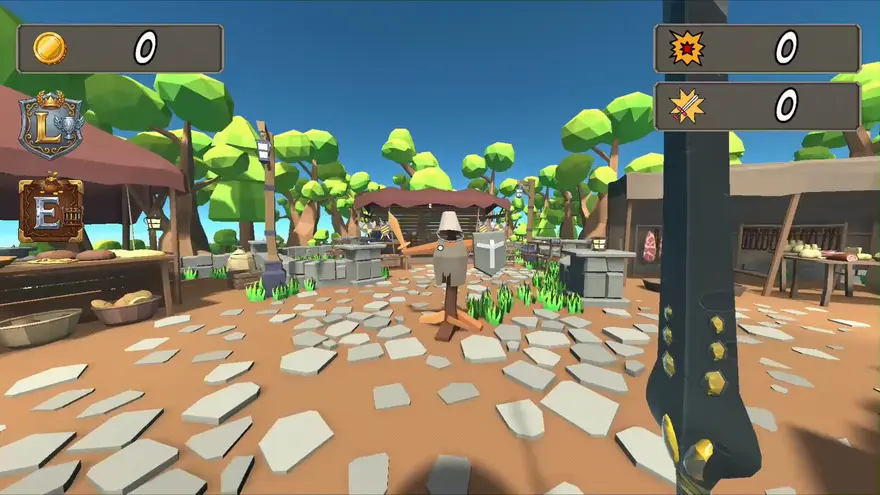
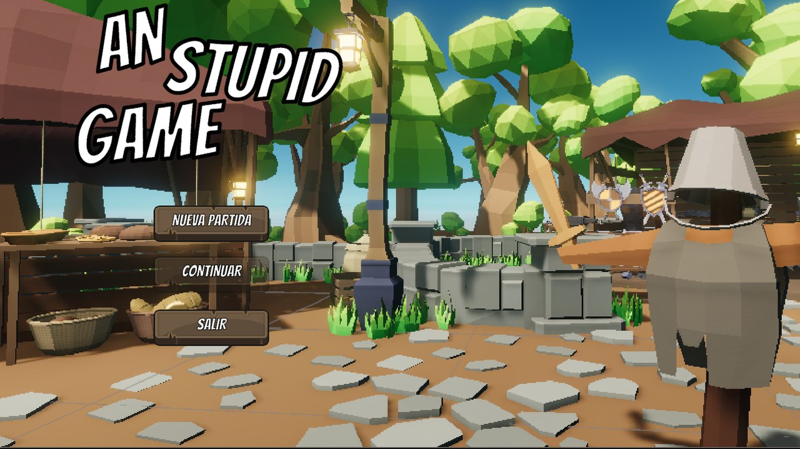
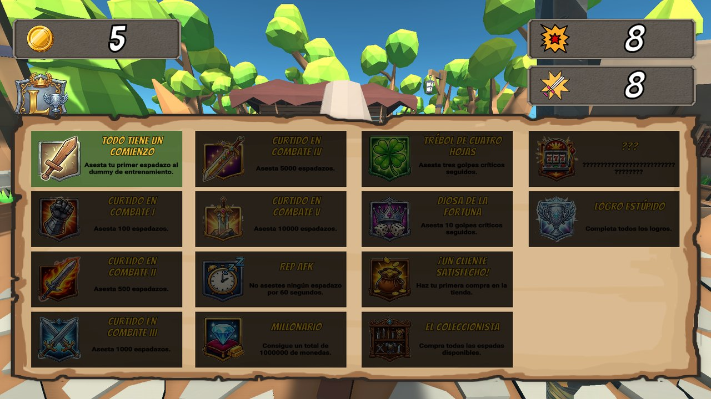
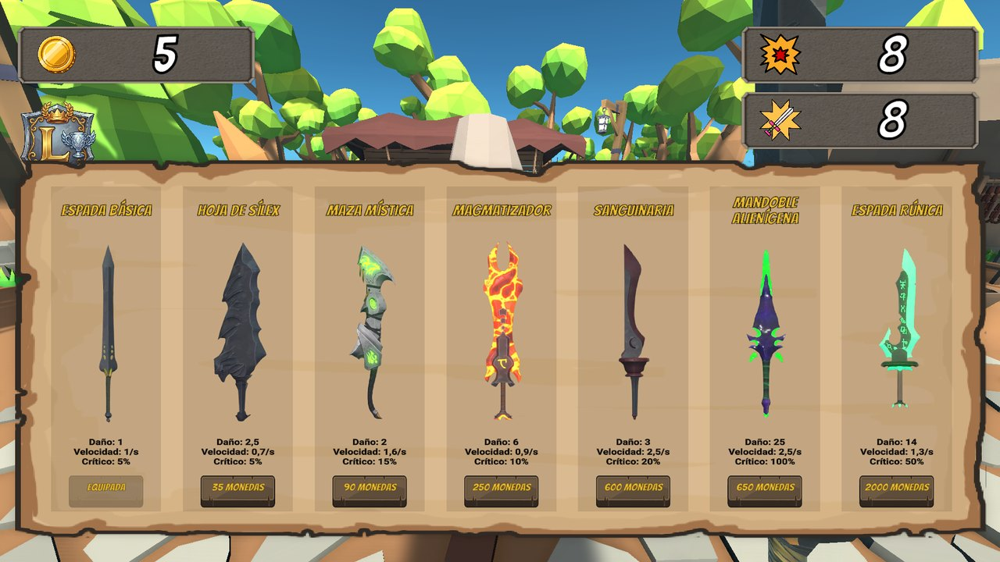

<div align="center">

# 🗡️ AnStupidGame

**Juego en primera persona de pegarle a un muñeco de entrenamiento con espadas, ganar monedas, comprar armas mejores y desbloquear logros**

[]()
[]()
[]()

</div>

---

## 📖 Sobre el proyecto

**AnStupidGame** es un juego deliberadamente tonto: apareces en medio de un mercado medieval, con una espada y un muñeco de entrenamiento delante, y poco más que hacer que **pegarle**. Cada golpe te acerca a monedas y logros, y las monedas sirven para comprar espadas que pegan más fuerte y más rápido. Pero hay un arma que no es de fiar.

> 📌 **Proyecto académico** del *Máster en Diseño y Desarrollo de Videojuegos* de la **UNIR**, hecho con Unity 6.

---

## 🖼️ Capturas

<p align="center">
  
</p>

<p align="center">
  
  
  
</p>

<p align="center"><em>Menú principal, logros y tienda.</em></p>

---

## 🎮 Cómo se juega

- **Ataca con el clic izquierdo.** El golpe lanza un *raycast* de 3 metros desde la cámara, y la cadencia depende del arma equipada.
- **Gana monedas** de dos formas: cada golpe al muñeco puede soltar monedas al azar (un 30 % de probabilidad en la configuración por defecto) y, además, se reparten bonificaciones al alcanzar cada 10 golpes y cada 10 puntos de daño acumulado.
- **Compra armas** en la tienda. Las espadas se distinguen por su **daño**, su **velocidad de ataque** y su **probabilidad de crítico**; por defecto, el crítico es del 5 % y multiplica el daño por 3.
- **Cuidado con el arma troll:** alguna de las espadas tiene un 5 % de probabilidad de rebotar y matarte al golpear, y en ese caso pierdes monedas y estadísticas.
- **No te caigas:** caer fuera del mapa también te mata.
- **Persigue los logros.** Hay contadores de espadazos (de 100 a 10 000, los cinco niveles de *Curtido en combate*), rachas de críticos (*Trébol de cuatro hojas* y *Diosa de la fortuna*), la primera compra, comprar todas las espadas (*El coleccionista*), llegar al millón de monedas, estar un minuto sin atacar (*Rep AFK*), algún logro oculto y un logro final, el *Logro estúpido*, por completarlos todos. Se guardan de forma permanente.

### 🛒 La tienda

Estas son las siete espadas, con los valores que muestra el propio juego:

| Espada | Daño | Velocidad | Crítico | Precio |
| :--- | :---: | :---: | :---: | :---: |
| Espada básica | 1 | 1/s | 5 % | Equipada |
| Hoja de sílex | 2,5 | 0,7/s | 5 % | 35 monedas |
| Maza mística | 2 | 1,6/s | 15 % | 90 monedas |
| Magmatizador | 6 | 0,9/s | 10 % | 250 monedas |
| Sanguinaria | 3 | 2,5/s | 20 % | 600 monedas |
| Mandoble alienígena | 25 | 2,5/s | 100 % | 650 monedas |
| Espada rúnica | 14 | 1,3/s | 50 % | 2000 monedas |

### 🕹️ Controles

| Acción | Teclado y ratón |
| :--- | :---: |
| Moverse | `W` `A` `S` `D` o flechas |
| Mirar | Ratón |
| Saltar | `Espacio` |
| Correr | `Mayús` izquierda |
| Atacar | Clic izquierdo |
| Abrir / cerrar la tienda | `E` |
| Abrir / cerrar los logros | `L` |
| Pausa | `Esc` |

---

## ✨ Qué incluye

- **Movimiento en primera persona** con los *Starter Assets* de Unity.
- **Siete espadas** definidas como datos (`ScriptableObject`), de la espada básica al mandoble alienígena.
- **Tienda** con las estadísticas de cada arma, sonidos de compra y de error.
- **Sistema de logros** con notificaciones emergentes y panel de consulta.
- **Guardado de partida** con *Continuar* y *Nueva partida* en el menú principal.
- **Menú principal, menú de pausa y HUD** con monedas, daño y golpes.

---

## 🚀 Cómo ejecutarlo

**Requisitos:** [Unity Hub](https://unity.com/download) y el editor **Unity 6000.3.10f1**.

1. En Unity Hub, *Add → Add project from disk* y elige la raíz de este repositorio.
2. Abre el proyecto con el editor 6000.3.10f1 (la primera vez tarda en importar los assets).
3. Abre la escena `Assets/Scenes/MenuPrincipal.unity` y pulsa **Play**.

No hay una versión compilada publicada.

---

## 🔧 Detalles técnicos

- **Armas como datos.** `DatosArma` es un `ScriptableObject` con daño, ataques por segundo, probabilidad y multiplicador de crítico, precio y un indicador de arma troll, así que añadir una espada nueva no requiere código.
- **Estado compartido** en `GestorJuego`, un *singleton* que lleva las monedas, el daño, los golpes y el estado de la partida, y avisa al HUD y a los logros.
- **Guardado con JSON.** `SistemaGuardado` serializa con `JsonUtility` las monedas, las estadísticas, las armas compradas, los logros, la posición y la espada equipada, y lo guarda en `PlayerPrefs`.
- **Logros ocultos** con contadores propios, por ejemplo uno que se desbloquea tras un minuto sin atacar.

---

## 📂 Estructura del repositorio

```
AnStupidGame/
├── Assets/
│   ├── Scenes/            # MenuPrincipal y GameScene
│   ├── Scripts/           # Combate, tienda, logros, guardado, HUD y menú
│   ├── Armas/             # Las espadas (ScriptableObjects) y su animación
│   ├── Images/            # Iconos de la interfaz, de los logros y de las espadas
│   ├── Prefabs/ · Sounds/
│   └── StarterAssets/     # Controlador en primera persona
├── Media/                 # Capturas y animación del juego
├── Packages/
└── ProjectSettings/
```

---

## 🖥️ Stack tecnológico

| Categoría | Herramientas |
| :--- | :--- |
| **Motor** | Unity 6 (6000.3.10f1) |
| **Lenguaje** | C# |
| **Entrada y texto** | Input System · TextMesh Pro |

---

## 🎨 Créditos de terceros

Este repositorio incluye recursos de otros autores, que conservan sus propias licencias: *Low-Poly Medieval Market*, *FreeSwords*, *Fantasy Wooden GUI Free*, un modelo de muñeco de entrenamiento y los *Starter Assets* de Unity, según el nombre de las carpetas.

---

## 👤 Autoría

**Unai García** — Máster en Diseño y Desarrollo de Videojuegos (UNIR)

- 🐙 GitHub: [@unaigb](https://github.com/unaigb)
- 🌐 Portfolio: [unaigb.dev](https://unaigb.dev)
